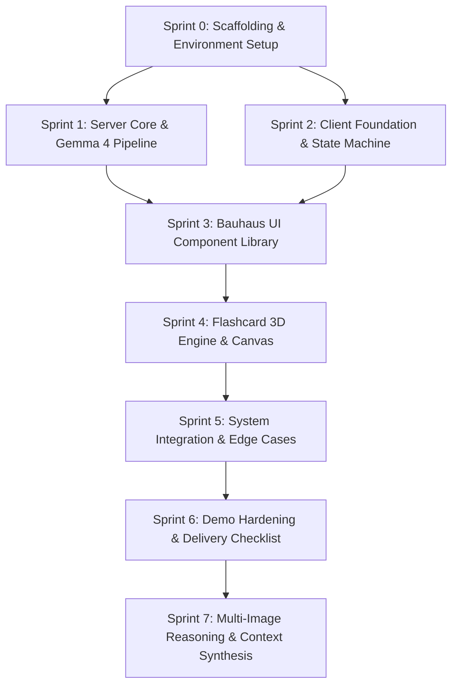
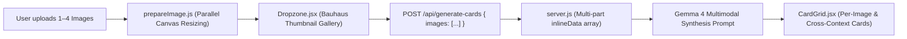

# GemmaFlash — Project Execution Plan & Sprint Roadmap

> **Authoritative Companion Docs:**
> - [GemmaFlash_PRD_v2.md](file:///home/nikhil/EduFlash/GemmaFlash_PRD_v2.md) (Product requirements, contracts, API, and validation rules)
> - [GemmaFlash_Design_v2.md](file:///home/nikhil/EduFlash/GemmaFlash_Design_v2.md) (Bauhaus design system, typography, tokens, and components)

---

## 1. Executive Summary & Project Baseline

### 1.1 Objective & Event Context
- **Product:** **GemmaFlash** — An active-recall flashcard generator that converts photos of handwritten notes, whiteboards, diagrams, and flowcharts into interactive study cards using Gemma 4's multimodal spatial reasoning.
- **Event:** Hacktoberfest Hack Day Hyderabad (MLH x NIAT – KKH).
- **Challenge:** **Best Use of Gemma 4** (Visual input → Structural reasoning → Structured output → Interactive learning).
- **Architecture:** Stateless web application with client-side image optimization and a server-side AI proxy. No external database or authentication required for v1.

### 1.2 Fixed Constraints & Non-Goals
| In Scope (Must / Should) | Out of Scope (Won't / v2) |
|---|---|
| Single-page responsive web app (Desktop 35/65, Mobile 1-col) | User accounts, auth, or databases |
| Multimodal Gemma 4 calls via `@google/genai` | Multi-image decks or PDF document parsing |
| Client-side canvas image downscale (longest edge ≤ 1568px) | Deck editing, spaced repetition algorithms (SM-2) |
| 3D mechanical flip cards with keyboard & accessibility support | Cloud file storage / persistence (S3, GCS) |
| Offline Demo Mode (`demoDeck.json`) | Export to Anki (`.apkg`) or Quizlet CSV |
| Dual-model fallback (`gemma-4-26b-a4b-it` → `gemma-4-31b-it`) | Internationalization (i18n) |

### 1.3 Technical Stack Specification
- **Client:** React 18, Vite 5, Tailwind CSS **3.4** (pinned v3 syntax with `tailwind.config.js`), Outfit font family.
- **Server:** Node.js 20+, Express 4, `cors`, `dotenv`, `@google/genai` SDK.
- **AI Models:** Primary `gemma-4-26b-a4b-it` (fast MoE), Fallback `gemma-4-31b-it` (dense high quality).
- **Protocol:** REST API over HTTP (`/api/generate-cards`, `/api/health`) with Vite reverse proxy.

---

## 2. Master Project File Architecture

The repository will adhere strictly to the tree structure defined in the PRD (§5.2):

```
EduFlash/
├── GemmaFlash_PRD_v2.md          # Source of truth: functional & AI contracts
├── GemmaFlash_Design_v2.md       # Source of truth: visual & layout tokens
├── project_execution.md          # Execution plan & sprint roadmap (this document)
├── client/
│   ├── index.html                # Google Font Outfit links & root mount
│   ├── package.json              # Client dependencies & scripts
│   ├── vite.config.js            # Dev proxy (/api -> http://localhost:8787)
│   ├── tailwind.config.js        # Bauhaus tokens, hard shadows, custom animations
│   ├── postcss.config.js         # Tailwind & Autoprefixer plugin config
│   └── src/
│       ├── main.jsx              # React DOM initialization
│       ├── App.jsx               # Finite State Machine & page layout
│       ├── index.css             # Tailwind base/utilities, dot grid, 3D flip classes
│       ├── lib/
│       │   ├── prepareImage.js   # Client canvas image resizing & base64 conversion
│       │   └── api.js            # API fetch wrapper, timeout handling & error parsing
│       ├── data/
│       │   └── demoDeck.json     # Hardcoded offline demo deck
│       └── components/
│           ├── Dropzone.jsx      # File upload, drag-and-drop, preview & validation
│           ├── Flashcard.jsx     # 3D interactive flip card with tags & difficulty
│           ├── CardGrid.jsx      # Responsive card list with staggered entrance
│           ├── LoadingBar.jsx    # Mechanical indeterminate progress bar
│           └── ErrorBanner.jsx   # Typed error alert banner with Retry / Demo actions
└── server/
    ├── package.json              # ES module configuration & dependencies
    ├── server.js                 # Express server, Google GenAI SDK integration & routes
    └── .env                      # API keys & model configuration (never committed)
```

---

## 3. Sprint Breakdown & Execution Roadmap

The execution is structured into **8 high-velocity sprints** designed to systematically construct, verify, and harden the application while maintaining strict fidelity to the PRD and Design specifications.



---

### Sprint 0: Scaffolding & Environment Setup

#### 1. Objectives & Scope
Establish the dual-workspace folder structure (`client/` and `server/`), install pinned dependencies, configure the Vite dev proxy, set up environment variables, and verify end-to-end network connectivity via the health check endpoint.

#### 2. Dependencies & Pre-conditions
- Node.js 20+ installed.
- Valid Gemini API key with access to Gemma 4 models.

#### 3. Step-by-Step Implementation Tasks
1. **Repository Scaffolding:**
   - Initialize `/server` as an ES module (`"type": "module"`).
   - Initialize `/client` using Vite + React template.
   - Create root `.gitignore` ensuring `.env`, `node_modules`, and build artifacts are excluded.
2. **Server Dependency Installation:**
   - Install `express`, `cors`, `dotenv`, and `@google/genai`.
   - Setup `server/.env` template with:
     ```env
     GEMINI_API_KEY=your_gemini_api_key
     PORT=8787
     CLIENT_ORIGIN=http://localhost:5173
     PRIMARY_MODEL=gemma-4-26b-a4b-it
     FALLBACK_MODEL=gemma-4-31b-it
     ```
3. **Server Health Endpoint:**
   - Create minimal `server/server.js` with CORS and `GET /api/health` returning `{ "ok": true }`.
4. **Client Setup & Dev Proxy:**
   - Install client dependencies: `react`, `react-dom`.
   - Install dev dependencies: `vite`, `@vitejs/plugin-react`, `tailwindcss@^3.4.0`, `postcss`, `autoprefixer`.
   - Initialize `client/vite.config.js` with proxy:
     ```js
     import { defineConfig } from 'vite';
     import react from '@vitejs/plugin-react';

     export default defineConfig({
       plugins: [react()],
       server: {
         proxy: {
           '/api': 'http://localhost:8787',
         },
       },
     });
     ```
5. **Bauhaus Theme Foundation:**
   - Configure `client/tailwind.config.js` with exact PRD/Design tokens:
     - Colors: `canvas` (`#F0F0F0`), `ink` (`#121212`), `bauhaus-red` (`#D02020`), `bauhaus-blue` (`#1040C0`), `bauhaus-yellow` (`#F0C020`).
     - Shadows: `hard` (`4px 4px 0 0 #121212`), `hard-lg` (`8px 8px 0 0 #121212`), `hard-xl` (`12px 12px 0 0 #121212`).
     - Animation: `load: 'load 1.1s linear infinite'`.
   - Setup `client/index.html` with Google Font Outfit (`400`, `500`, `700`, `900`).
   - Setup `client/src/index.css` with `@tailwind` directives, `.bg-bauhaus-grid`, 3D transform utilities, and `prefers-reduced-motion`.

#### 4. Verification & Acceptance Checkpoints
- [ ] Run `npm run dev` in `server/` (listens on 8787).
- [ ] Run `npm run dev` in `client/` (listens on 5173).
- [ ] `curl -i http://localhost:8787/api/health` returns `HTTP/200` with `{"ok":true}`.
- [ ] In browser, open `http://localhost:5173/api/health` and verify Vite proxy successfully forwards to Express server.
- [ ] Verify Outfit font loads without console warnings or layout shift.

---

### Sprint 1: Server Core & Gemma 4 AI Pipeline

#### 1. Objectives & Scope
Implement the full AI generation pipeline in `server/server.js`, including request validation, multimodal payload packaging, model execution with strict 25-second timeouts, fallback model orchestration, tolerant JSON parsing, and card data sanitization.

#### 2. Dependencies & Pre-conditions
- Completion of Sprint 0.
- Verified `GEMINI_API_KEY` in `server/.env`.

#### 3. Step-by-Step Implementation Tasks
1. **Contract Definitions in Server:**
   - Define exact `SYSTEM_PROMPT` per PRD §8.2 (instructions on handwriting, arrows, relationships, 6–10 cards, concise back/front, JSON output only).
   - Define `SCHEMA` object for Gemini API structured output per PRD §7.3.
   - Define MIME type whitelist: `['image/png', 'image/jpeg', 'image/jpg']`.
2. **Resilient Parsing & Data Cleaning (`parseCards`):**
   - Implement tolerant markdown stripper (handling ````json ... ```` fences or raw strings).
   - Implement substring boundary fallback slicing from first `[` to last `]`.
   - Validate card array structure:
     - Drop items missing non-empty string `front` or `back`.
     - Truncate `front` ≤ 140 chars, `back` ≤ 280 chars.
     - Default missing/empty `tag` to `"General"`.
     - Validate `difficulty` to `"easy" | "medium" | "hard"`, defaulting to `"medium"`.
     - Deduplicate cards by lowercase `front`.
     - Cap at 12 cards.
     - Throw `BAD_MODEL_OUTPUT` if fewer than 3 valid cards remain.
3. **Model Invocation & Fallback Logic (`callModel` & `/api/generate-cards`):**
   - Wrap `@google/genai` call in a 25,000 ms timeout race (`withTimeout`).
   - Model iteration order:
     - Primary: `process.env.PRIMARY_MODEL || 'gemma-4-26b-a4b-it'`.
     - Fallback: `process.env.FALLBACK_MODEL || 'gemma-4-31b-it'`.
   - Schema fallback strategy:
     - First attempt with `responseSchema`.
     - If the Gemini API returns a 400 error due to schema rejection, immediately retry without `responseSchema` relying on prompt + tolerant parser.
   - If primary model times out or errors, transition to fallback model.
4. **Standardized Error Handling:**
   - Return strict contract error JSON: `{ error: { code, message } }`.
   - Implement HTTP codes: `400 BAD_REQUEST`, `415 UNSUPPORTED_TYPE`, `502 BAD_MODEL_OUTPUT`, `502 MODEL_FAILED`, `504 TIMEOUT`.

#### 4. Verification & Acceptance Checkpoints
- [ ] Prepare test base64 string of a sample diagram image.
- [ ] Execute `curl` test against `POST /api/generate-cards`:
  ```bash
  curl -X POST http://localhost:8787/api/generate-cards \
    -H "Content-Type: application/json" \
    -d '{"imageBase64":"...","mimeType":"image/jpeg"}'
  ```
- [ ] Verify server returns HTTP 200 with `cards` array (length 6–10) and `model` name.
- [ ] Test negative cases:
  - Missing payload -> 400 `BAD_REQUEST`.
  - PDF/GIF mimeType -> 415 `UNSUPPORTED_TYPE`.
- [ ] Verify at least 2 cards test diagram flow / relationship (e.g., arrow sequence or dependency).

---

### Sprint 2: Client Foundation, State Machine & Utilities

#### 1. Objectives & Scope
Build client-side utilities (`prepareImage.js`, `api.js`), static demo deck data (`demoDeck.json`), local storage persistence, and the core Finite State Machine in `App.jsx`.

#### 2. Dependencies & Pre-conditions
- Completion of Sprint 0.
- PRD contract specifications (§5.3, §7.4, §9.2).

#### 3. Step-by-Step Implementation Tasks
1. **Client Image Optimizer (`client/src/lib/prepareImage.js`):**
   - Implement `prepareImage(file, maxEdge = 1568, quality = 0.85)` using `createImageBitmap` and `HTMLCanvasElement`.
   - Enforce aspect ratio preservation with downscaling if longest edge > 1568px.
   - Fill white background (`#FFFFFF`) to handle transparent PNGs before converting to JPEG.
   - Return `{ previewUrl, imageBase64, mimeType: 'image/jpeg' }`.
2. **API Client Layer (`client/src/lib/api.js`):**
   - Implement `generateCardsAPI(imageBase64, mimeType)`.
   - Use relative endpoint `/api/generate-cards`.
   - Parse error payloads cleanly into typed JS error instances matching PRD codes.
3. **Demo Deck Data (`client/src/data/demoDeck.json`):**
   - Bundle the pre-baked 6-card TCP handshake deck from PRD §7.4 to enable instant offline demonstration.
4. **Client State Machine (`client/src/App.jsx`):**
   - Define state: `{ status, imagePreviewUrl, imageB64, mimeType, cards, error }`.
   - Transitions:
     - `idle` → `ready` on image drop/select.
     - `ready` → `loading` on clicking Generate.
     - `loading` → `success` on cards returned.
     - `loading` → `error` on API failure.
     - Any state → `idle` on Reset.
     - Any state → `success` on "Load Example" (loads `demoDeck.json` with 0 network calls).
5. **Local Storage Persistence Layer:**
   - Save cards to `localStorage.setItem('gemmaflash.deck.v1', JSON.stringify(cards))` on `success`.
   - Attempt restore on mount wrapped in `try/catch` to fail silently if `localStorage` is disabled or full.

#### 4. Verification & Acceptance Checkpoints
- [ ] Dropping a 4000x3000px image produces a canvas image with max dimension ≤ 1568px.
- [ ] Clicking "Load Example" switches status directly to `success` and populates the cards state without triggering network requests.
- [ ] Disabling network in DevTools still allows "Load Example" to work flawlessly.
- [ ] Reloading page restores cached deck from `localStorage` if present.

---

### Sprint 3: Bauhaus UI Component Library & Layout

#### 1. Objectives & Scope
Construct the two-column responsive layout and reusable Bauhaus components adhering strictly to the Hard Rules (R1–R8): zero blur, zero gradients, 100% ink hard shadows, sharp corners (`rounded-none`), and high-contrast colorways.

#### 2. Dependencies & Pre-conditions
- Completion of Sprint 1 & Sprint 2.
- Tailwind tokens and global CSS configured in Sprint 0.

#### 3. Step-by-Step Implementation Tasks
1. **Master Page Layout (`App.jsx`):**
   - Desktop (≥ `lg`): Two columns `grid-cols-[35%_65%]`, full viewport height, separated by `border-r-4 border-ink`.
   - Mobile (< `lg`): Single column stacked layout (Control Panel on top, Canvas below).
   - Left Panel (Control Panel): `bg-bauhaus-yellow p-6 md:p-8`.
   - Right Canvas (Flashcard Canvas): `bg-canvas bg-bauhaus-grid p-6 md:p-10`.
2. **Wordmark & Typography Header:**
   - Construct "GEMMA" (Ink text) + "FLASH" (Red rectangular block with white text), `font-black text-3xl uppercase`.
3. **Dropzone Component (`client/src/components/Dropzone.jsx`):**
   - Accessible `<label>` container wrapping hidden `<input type="file" accept="image/png,image/jpeg">`.
   - Base state: white surface, `border-2 md:border-4 border-ink`, `shadow-hard-lg`.
   - Drag-over state: active color swap to `bg-bauhaus-blue text-white` (instant 100ms transition).
   - Decorative bottom-right geometric elements: red circle + blue triangle (hidden when preview exists).
   - Preview mode: `object-contain` thumbnail with yellow "REPLACE" badge.
   - Validation feedback: inline red box with white text for invalid files (e.g. PDF/GIF or >10MB).
4. **Button Variants:**
   - Primary ("GENERATE CARDS"): `bg-bauhaus-red text-white font-black tracking-widest py-4 px-8 w-full shadow-hard active:translate-x-1 active:translate-y-1 active:shadow-none`.
   - Secondary ("LOAD EXAMPLE", "RESET", "RETRY"): `bg-white text-ink font-bold py-2 px-4 shadow-hard`.
   - Disabled states: flat style without shadow, depressed position, no opacity reduction.
5. **LoadingBar Component (`client/src/components/LoadingBar.jsx`):**
   - White container with `border-2 md:border-4 border-ink`.
   - Black ink inner bar (`w-1/4 bg-ink animate-load`) sweeping horizontally.
   - Accessibility: `role="status"` and `aria-live="polite"`.
6. **ErrorBanner Component (`client/src/components/ErrorBanner.jsx`):**
   - `bg-bauhaus-red text-white border-2 md:border-4 border-ink shadow-hard p-4 font-bold` with `role="alert"`.
   - Action buttons: "Retry" and "Load Example".
7. **Empty State Hero Canvas:**
   - Render in right canvas when `idle` or `ready`.
   - Headline: "DROP A DIAGRAM. GET FLASHCARDS." (`text-5xl md:text-8xl font-black uppercase tracking-tighter`).
   - Geometric icon trio: Red circle, Blue square, Yellow triangle with black ink borders.
   - Subtitle: "Handwritten notes · Whiteboards · Flowcharts".

#### 4. Verification & Acceptance Checkpoints
- [ ] Verify Bauhaus aesthetic across desktop (1440px) and mobile (390px).
- [ ] Dragging file over Dropzone flips background to Bauhaus Blue instantly.
- [ ] Dropzone keyboard navigation: focus visible ring appears, pressing Enter/Space opens native file selector.
- [ ] Buttons physically depress 4px (`translate-x-1 translate-y-1`) with zero shadow on press.

---

### Sprint 4: Flashcard Engine & 3D Interactive Canvas

#### 1. Objectives & Scope
Implement the interactive 3D flashcard component (`Flashcard.jsx`) and container grid (`CardGrid.jsx`) ensuring smooth 250ms flips, independent hover elevation, accessible keyboard controls, and clear visual hierarchy.

#### 2. Dependencies & Pre-conditions
- Completion of Sprint 3.
- Design doc §5.6, §5.7, and §9.2 specifications.

#### 3. Step-by-Step Implementation Tasks
1. **Interactive Flashcard (`client/src/components/Flashcard.jsx`):**
   - **Two-layer architecture:**
     - Outer wrapper: handles hover lift (`hover:-translate-y-2`) and perspective (`[perspective:1200px]`).
     - Inner card element: handles 3D rotation (`preserve-3d`, `rotate-y-180`, 250ms cubic-bezier transition).
   - Flip trigger: full-card `<button type="button">` with `aria-pressed={flipped}` and descriptive `aria-label`.
   - **Front Face:**
     - Pure white surface, `border-2 md:border-4 border-ink`, `shadow-hard-lg`.
     - Top-left: Yellow topic badge (`tag`).
     - Top-right: Difficulty indicator (3 discrete squares filled per level).
     - Center: Question text (`text-xl md:text-2xl font-bold uppercase tracking-tight`), internal scroll for overflow.
     - Bottom-right: Rotating geometric shape based on index (Red circle, Blue square, Yellow triangle).
   - **Back Face:**
     - Alternating colorway: even index = `bg-bauhaus-red`, odd index = `bg-bauhaus-blue`.
     - Text: white, left-aligned answer (`text-base md:text-lg font-medium leading-relaxed`).
     - Bottom-left: "TAP TO FLIP BACK" label in uppercase tracking-widest text.
     - Bottom-right: `overflow-y-auto` internal container preventing text overflow.
2. **Flashcard Grid (`client/src/components/CardGrid.jsx`):**
   - Layout: `grid grid-cols-1 sm:grid-cols-2 gap-8`.
   - Header bar: Card count indicator (`{n} CARDS`) on the left, "Reset" secondary button on the right.
   - Entrance choreography: Staggered entrance animation with 60ms delay increment.
   - Motion reduction: Disable flip transition and entrance animation when `prefers-reduced-motion: reduce` is detected.

#### 4. Verification & Acceptance Checkpoints
- [ ] Card flips smoothly on mouse click without flicker, mirrored text, or backface bleed.
- [ ] Card flips via keyboard (Tab focus + Enter or Space).
- [ ] Hovering over a card raises it by 8px with `shadow-hard-xl` without interfering with 3D flip rotation.
- [ ] Test with a long question (140 chars) and long answer (280 chars) to confirm text stays strictly within borders.
- [ ] Even cards display red backs; odd cards display blue backs.

---

### Sprint 5: System Integration, End-to-End Validation & Edge Cases

#### 1. Objectives & Scope
Wire the end-to-end user loop (Drop image → Optimize client-side → Send to server → Execute Gemma 4 pipeline → Render interactive cards), validate all PRD edge cases, and ensure robust error recovery.

#### 2. Dependencies & Pre-conditions
- Completion of Sprints 0 through 4.
- Running client and server instances.

#### 3. Step-by-Step Implementation Tasks
1. **End-to-End Flow Wiring:**
   - In `App.jsx`, wire `Dropzone` output to `prepareImage` utility.
   - Wire "Generate Cards" button click to `api.generateCardsAPI`.
   - Transition state machine: `ready` → `loading` (display `LoadingBar`, lock inputs) → `success` (render `CardGrid`).
2. **Edge Case Hardening (per PRD §11):**
   - **Invalid File Type:** Attempt dropping PDF, GIF, HEIC → inline error banner "PNG or JPEG only", state remains `idle`.
   - **File Exceeds 10MB:** Reject raw files > 10MB immediately on drop before canvas processing.
   - **Non-Study / Blurry Image:** Server receives image where Gemma 4 returns `[]` → trigger `BAD_MODEL_OUTPUT` error banner: "Couldn't read usable flashcards from that image. Try a clearer photo."
   - **API / Network Failure:** Simulate offline server → display error banner "Can't reach server" with "Retry" and "Load Example" buttons.
   - **Request Timeout:** Enforce 25s limit → display `TIMEOUT` error banner with retry options.
   - **Double-click Prevention:** Ensure "Generate Cards" is disabled and displays "WORKING…" while status is `loading`.
   - **Drop during loading:** Ignore drag-and-drop events when status is `loading`.
3. **Core Success Criteria Verification:**
   - **S1:** Perform full generation flow twice consecutively without page reload.
   - **S2:** Verify response time under 20s.
   - **S3:** Verify at least one card tests diagram directional flow or relationship.
   - **S4:** Turn off network / disconnect Wi-Fi and verify "Load Example" renders `demoDeck.json` immediately.

#### 4. Verification & Acceptance Checkpoints
- [ ] Execute test run with real diagram image (e.g. TCP Handshake or System Architecture).
- [ ] Verify all 9 edge cases in PRD §11 produce specified UI behaviors.
- [ ] Confirm no blank screen states or unhandled promise rejections occur during failures.
- [ ] Confirm zero API keys appear in client source code or network bundles.

---

### Sprint 6: Hackathon Polish, Demo Choreography & Pitch Readiness

#### 1. Objectives & Scope
Perform comprehensive visual QA, execute the 30-second live demo choreography, prepare fallback contingencies, record a backup screen demo, and draft the final project documentation.

#### 2. Dependencies & Pre-conditions
- Fully integrated application passing all Sprint 5 checkpoints.

#### 3. Step-by-Step Implementation Tasks
1. **Visual QA Audit (per Design doc §12):**
   - Verify strict color adherence: only Canvas, Ink, Red, Blue, Yellow, and White are present.
   - Confirm zero border radii (`rounded-none`) except for circular badges and tags.
   - Confirm all borders are 4px on desktop and 2px on mobile.
   - Confirm all shadows are 100% opaque Ink hard offsets.
   - Audit color contrast: Ink on Canvas/White/Yellow; White on Red/Blue (no low-contrast pairings).
2. **Demo Choreography Rehearsal (30-second path):**
   - *T = 0s:* Start on idle state with Bauhaus poster hero.
   - *T = 5s:* Drag demo diagram into Dropzone; Dropzone flashes Blue; Generate button activates.
   - *T = 8s:* Click "Generate Cards"; button depresses; LoadingBar animates at top.
   - *T = 18s:* 6–10 cards populate grid with staggered entrance.
   - *T = 25s:* Click a relationship card (e.g., "What comes after SYN?"); reveal color-blocked back face.
   - *Pitch Delivery:* "Traditional OCR flattens diagrams into disconnected words. Gemma 4 reads the visual hierarchy and arrows to construct active-recall flashcards in under 20 seconds."
3. **Contingency & Fallback Drill:**
   - Practice immediate click on "Load Example" if network latency exceeds 10s.
   - Narration script: "If live venue Wi-Fi stutters, our offline cached mode demonstrates the identical validated deck structure instantly."
4. **Backup Artifacts & README:**
   - Record backup screen video of the flawless demo flow.
   - Create clean project `README.md` with:
     - 3-step setup instructions (`npm install`, `.env` template, `npm run dev`).
     - Architectural summary highlighting Gemma 4 multimodal capabilities.

#### 4. Verification & Acceptance Checkpoints
- [x] All checkboxes in Definition of Done (§4) validated.
- [x] Rehearsed live demo twice with zero hiccups.
- [x] Screen recording saved in repository root as backup artifact.
- [x] Final code audit confirms no untracked `.env` files or debugging logs.

---

### Sprint 7: Multi-Image Multimodal Reasoning & Cross-Context Synthesis

#### 1. Objectives & Scope
Expand GemmaFlash to accept **multiple images sharing the same educational context** (e.g., multi-page handwritten notes, sequential flowchart steps, client/server architectural diagrams, or before-and-after states). Leverage Gemma 4's native multi-image multimodal reasoning to process all images within a single context window, ensuring that:
1. The generated active-recall cards cover **all uploaded images**.
2. There is **at least one card dedicated to EACH individual image**.
3. There are **at least two cross-image cards** explicitly testing relationships, sequences, transitions, or dependencies *between* the images.
4. Total cards generated: 6 to 12 cards.
5. Max image limit: 4 images per session (maintaining high speed and remaining well under the 8 MB body payload limit).



#### 2. Dependencies & Pre-conditions
- Completion of Sprints 0 through 6.
- Server running with `@google/genai` and `GEMINI_API_KEY`.
- Pinned Bauhaus design tokens (R1–R8).

#### 3. Step-by-Step Implementation Tasks

##### A. Client Multi-Image Gallery & Selection (`Dropzone.jsx`)
1. **Multi-File Selection & Drag-and-Drop:**
   - Add `multiple` attribute to `<input type="file">`.
   - Update `handleDrop` and `handleChange` to accept multiple files: `Array.from(files)`.
   - Impose cap: max 4 images total. If user selects more than 4, take first 4 and show an inline alert: *"Maximum 4 images allowed per study deck."*
2. **Bauhaus Multi-Image Thumbnail Gallery:**
   - When images exist (`images.length > 0`), display a responsive grid/carousel inside the Dropzone frame.
   - For each image:
     - Show downscaled thumbnail with 2px Ink border and hard shadow.
     - Label with Bauhaus badge: `IMAGE 1`, `IMAGE 2`, etc.
     - Individual **"✕" (Remove)** button to delete specific images from the session.
   - If `images.length < 4`, show an inline **"+ ADD MORE"** mechanical slot allowing users to append more images.
   - Provide a **"CLEAR ALL"** button to reset the selection.

##### B. Client Preparation Engine (`prepareImage.js` & `App.jsx`)
1. **Batch Parallel Image Preparation:**
   - Process multiple files concurrently via `Promise.all(files.map(f => prepareImage(f)))`.
   - Maintain image order (`images[0] = Image 1`, `images[1] = Image 2`, etc.).
   - State shape update in `App.jsx`:
     ```javascript
     {
       images: [
         { previewUrl, imageBase64, mimeType, name, id },
         ...
       ]
     }
     ```
2. **State Machine Updates:**
   - `idle`: 0 images selected.
   - `ready`: 1 to 4 images selected; "GENERATE CARDS" enabled with dynamic label:
     - `1 image`: `GENERATE CARDS (1 IMAGE)`
     - `N images`: `GENERATE CARDS (N IMAGES)`
   - `loading`: Inputs locked, LoadingBar sweeping, status text: *"Gemma 4 is synthesizing concepts across all images…"*.

##### C. API Contract Extension (`server.js`)
1. **Flexible Backward-Compatible Payload:**
   - Accept either multi-image array or legacy single-image body:
     ```json
     {
       "images": [
         { "imageBase64": "...", "mimeType": "image/jpeg" },
         { "imageBase64": "...", "mimeType": "image/jpeg" }
       ]
     }
     ```
   - Validation: Ensure `images` is non-empty array (1 to 4 items) and every item contains valid `imageBase64` and supported `mimeType`.
2. **Standardized Response:**
   - Returns `{ cards: [...], model: "gemma-4-26b-a4b-it", imageCount: N }`.

##### D. Prompt Engineering for Comprehensive Coverage (`server.js`)
1. **System Prompt Rules Enhancement:**
   - Update `SYSTEM_PROMPT` to enforce explicit coverage across multi-image sets:
     ```
     When multiple images are provided (Image 1, Image 2, ..., Image N):
     - Treat all images as a unified, continuous study document.
     - MANDATORY COVERAGE: You MUST generate at least ONE card testing content from EACH individual image.
     - CROSS-IMAGE SYNTHESIS: You MUST generate at least TWO cards testing the connection, sequence, dependency, or relationship BETWEEN the different images (e.g. how Image 1 connects to Image 2).
     - Tags should reflect the source image or connection (e.g. "Image 1: Setup", "Image 2: State", "Cross-Diagram Flow").
     ```
2. **Multi-Part Message Construction:**
   - Map each image into its own `inlineData` part:
     ```javascript
     const parts = images.map((img, i) => ({
       inlineData: { mimeType: img.mimeType, data: img.imageBase64 },
     }));
     parts.push({
       text: `Analyze all ${images.length} images in order (Image 1 to Image ${images.length}). Generate 6 to 12 active-recall flashcards. Ensure at least one card tests each image, and at least two cards test cross-image relationships.`,
     });
     ```

##### E. Flashcard UI Tags & Metadata (`Flashcard.jsx`)
1. **Source Image Indicator:**
   - Display topic tag with enhanced styling reflecting context (`Image 1`, `Image 2`, or `Cross-Image`).

#### 4. Verification & Acceptance Checkpoints
- [ ] Uploading 2 distinct diagrams in the Dropzone shows two numbered thumbnails with remove buttons.
- [ ] "+ Add More" successfully appends a 3rd image up to 4 images.
- [ ] Removing an image updates the gallery and state cleanly.
- [ ] Calling `POST /api/generate-cards` with 2 diagram images returns 6–12 cards.
- [ ] Verified that output contains cards testing Image 1, cards testing Image 2, and cards testing their cross-image relationship.
- [ ] Generation finishes within timeout limit.
- [ ] Live browser test via subagent records complete multi-image workflow.

---

## 4. Definition of Done (DoD) Checklist

| Item | Requirement | Verification Method | Status |
|---|---|---|---|
| **D1** | Live demo flow runs twice in a row without reload or crash | Manual test with test diagram | [x] Verified |
| **D2** | "Load Example" works with network completely disabled | DevTools Offline mode test | [x] Verified |
| **D3** | Edge cases in PRD §11 tested and handled gracefully | Edge case test suite | [x] Verified |
| **D4** | Zero API keys in client bundle, client network tab, or git | Client build inspection & git log | [x] Verified |
| **D5** | Layout verified on desktop (1440px) and mobile (390px) | Chrome DevTools device mode | [x] Verified |
| **D6** | Strict Bauhaus compliance (6 colors, hard shadows, 0 blur/radii) | Visual QA checklist audit | [x] Verified |
| **D7** | Accessible keyboard navigation (Tab, Enter, Space flip) | Keyboard-only user test | [x] Verified |
| **D8** | README contains clear setup steps and `.env` template | Fresh clone test | [x] Verified |
| **D9** | Backup screen recording saved locally | Video file check | [x] Verified |
| **D10** | Multi-image selection (1–4 images) with Bauhaus thumbnail gallery & removal | UI inspection in browser | [x] Verified |
| **D11** | Multi-image Gemma 4 inference produces coverage across all images (≥1 per image + cross-image) | Automated test with 2 test diagrams | [x] Verified |

---

## 5. Risk Management & Mitigation Matrix

| Risk | Impact | Probability | Mitigation Strategy |
|---|---|---|---|
| **Venue Wi-Fi Latency / Dropout** | High | High | Primary/Fallback model timeout (25s); instant one-click "Load Example" fallback button that requires 0 network calls. |
| **Gemma 4 Schema Rejection (HTTP 400)** | High | Medium | Dual-pass invocation in `server.js`: automatically retries without `responseSchema` if the API rejects it, parsing JSON via tolerant regex parser. |
| **Large Camera Photo Overhead** | Medium | High | `prepareImage.js` downscales longest edge to ≤ 1568px and re-encodes to JPEG (quality 0.85) entirely in browser canvas before network upload. |
| **Model Output Hallucination / Formatting Error** | Medium | Medium | Tolerant parser slices between `[` and `]`; sanitizes, deduplicates, and validates each card; falls back to secondary model if < 3 valid cards. |
| **Tailwind v4 vs v3 Incompatibility** | High | Low | Explicitly pin Tailwind CSS to **3.4** in `package.json`; use classic `tailwind.config.js` and `@tailwind` directives. |
| **Card Flip Text Mirroring / Flicker** | Low | Low | Isolate 3D perspective to inner container; set `backface-hidden` and `-webkit-backface-visibility: hidden` with explicit 180° rotation on back face. |

---

## 6. PRD Feature Traceability Matrix

| Feature ID | PRD Section | Feature Description | Target Sprint | Primary Artifact |
|---|---|---|---|---|
| **F1** | §3, §5.2 | Drag-and-drop / file picker | Sprint 3 | `client/src/components/Dropzone.jsx` |
| **F2** | §3, §9.2 | Client image downscaling & base64 prep | Sprint 2 | `client/src/lib/prepareImage.js` |
| **F3** | §3, §6 | `POST /api/generate-cards` API route | Sprint 1 | `server/server.js` |
| **F4** | §3, §7, §8 | Gemma 4 call with strict JSON contract | Sprint 1 | `server/server.js` |
| **F5** | §3, §5.6 | 3D Flashcard grid with flip interaction | Sprint 4 | `client/src/components/Flashcard.jsx` |
| **F6** | §3, §7.4 | Offline Demo mode ("Load Example") | Sprint 2 | `client/src/data/demoDeck.json` |
| **F7** | §3, §5.3, §5.4 | LoadingBar & ErrorBanner | Sprint 3 | `LoadingBar.jsx`, `ErrorBanner.jsx` |
| **F8** | §3, §5.3 | LocalStorage deck persistence | Sprint 2 | `client/src/App.jsx` |
| **F9** | §3, §8.3 | Dual-model fallback (`26b` → `31b`) | Sprint 1 | `server/server.js` |
| **F10** | §3 | Reset flips & deck reset button | Sprint 4 | `client/src/components/CardGrid.jsx` |
| **F11** | §3 | Bauhaus styling & accessibility | Sprints 0, 3, 4 | `tailwind.config.js`, `index.css` |
| **F12** | Sprint 7 | Multi-Image Multimodal Reasoning & Synthesis | Sprint 7 | `Dropzone.jsx`, `prepareImage.js`, `server.js`, `App.jsx` |
